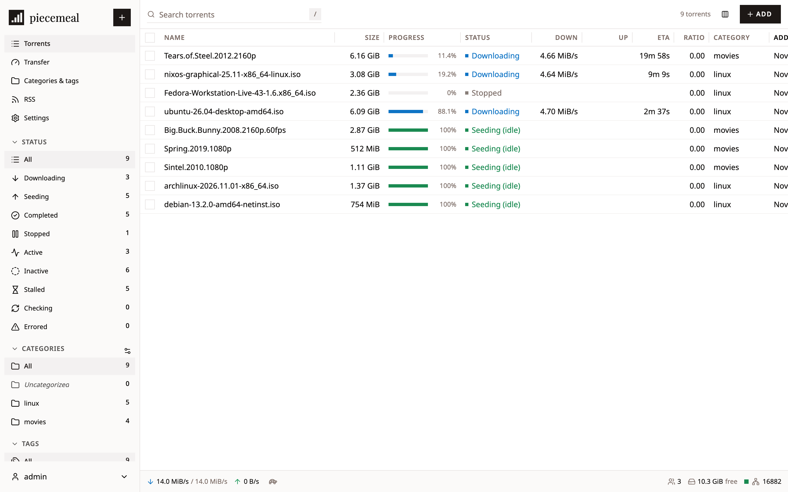

# piecemeal

A self-hosted BitTorrent client: one Go binary built on [anacrolix/torrent](https://github.com/anacrolix/torrent), with a modern web UI, its own REST API, and the qBittorrent WebAPI, so Radarr, Sonarr, Prowlarr and VueTorrent work with it as they do with qBittorrent.

**[Website and docs](https://piecemeal-flax.vercel.app)** · [Install](docs/install.md) · [Configuration](docs/configuration.md) · [API reference](https://piecemeal-flax.vercel.app/reference)

<picture>
  <source media="(prefers-color-scheme: dark)" srcset="website/assets/screens/list-dark.png">
  
</picture>

## Features

- **A drop-in for the \*arrs.** Add piecemeal as a qBittorrent download client, with a scoped API key. CI runs Radarr, Sonarr and Prowlarr against it, and compares its API with a real qBittorrent 5.3.
- **A web UI for desktop and phone**, with live updates, keyboard shortcuts, filters by state, category, tag and tracker, file priorities and renames, and a live piece map.
- **Users and SSO**: a local admin, plus users from any OpenID Connect provider with allowed and admin groups, and API keys scoped to full access, the qBittorrent API, or reading.
- **RSS** feeds and download rules with qBittorrent's matching, episode filters and the smart episode filter.
- **Queueing, seeding goals, speed limits** and a schedule for alternative limits.
- **VPN-friendly**: run in a WireGuard container and forward the peer port with NAT-PMP.
- **Safe by default**: confined save paths, an SSRF filter on fetched URLs, sign-in limits, CSRF checks and an audit log.
- **Operable**: Prometheus metrics, health checks, online backups, and import from Transmission and qBittorrent.

## Quick start

```sh
docker run --rm -i ghcr.io/sebdanielsson/piecemeal hash-password   # type a password, copy the hash
docker run -d --name piecemeal \
  -p 8080:8080 -p 6881:6881 -p 6881:6881/udp \
  -v piecemeal-data:/data -v /path/to/downloads:/downloads \
  -e PIECEMEAL_ADMIN_PASSWORD_HASH='$argon2id$...' \
  ghcr.io/sebdanielsson/piecemeal:latest
```

Open `http://localhost:8080` and sign in as `admin`. Then [connect Radarr, Sonarr and Prowlarr](docs/guides/arr.md), or [move your torrents from Transmission or qBittorrent](docs/guides/import.md).

## Documentation

The docs are in [`docs/`](docs) and on the [website](https://piecemeal-flax.vercel.app/docs):

- [Install](docs/install.md), [configuration](docs/configuration.md), [backup and restore](docs/guides/backup.md)
- [Radarr, Sonarr and Prowlarr](docs/guides/arr.md), [reverse proxy](docs/guides/reverse-proxy.md), [single sign-on](docs/guides/sso.md), [VPN and port forwarding](docs/guides/vpn.md)
- [Web UIs](docs/features/web-ui.md), [RSS](docs/features/rss.md), [APIs](docs/reference/api.md), [qBittorrent compatibility](docs/reference/qbittorrent-compat.md)
- [Security](docs/reference/security.md), [performance](docs/reference/performance.md), [troubleshooting](docs/help/troubleshooting.md), [FAQ](docs/help/faq.md)

## Contributing

See [Development](docs/help/development.md) for building, testing and conventions. Report security issues privately through [GitHub's vulnerability reporting](https://github.com/sebdanielsson/piecemeal/security/advisories/new).

## License

[MIT](LICENSE)
