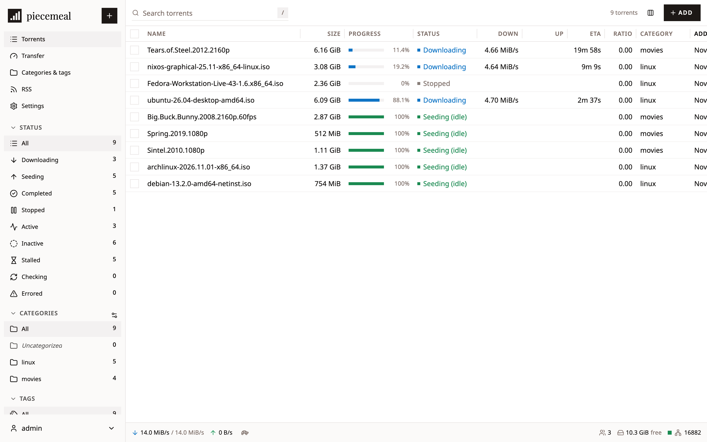

# Web UIs

piecemeal's web UI is at `/`, built into the binary. It updates live over server-sent events, follows the system's light or dark theme (or the one you pick), and works on a phone as well as a desktop.



## Torrents

- **The list** shows every torrent with its size, progress, state, rates, ETA, ratio, category and more. Choose which columns to show, resize them, sort by any of them, and search by name.
- **The sidebar** filters by state (downloading, seeding, completed, stopped, active, inactive, stalled, checking, errored), category, tag and tracker, with a count beside each.
- **Select** one torrent, a range with Shift, or all of them, and act on them from the toolbar or a right-click menu: start, stop, force-start, recheck, reannounce, set the category and tags, move the data, move them in the queue, copy magnet links, export the `.torrent`, or remove them, with or without their data.
- **Details** open below the list: transfer totals, torrent information and options such as seeding goals, files (set priorities, skip files, rename files and folders), peers, trackers (add, edit and remove), and a live map of the pieces.
- **Add** torrents from magnet links, URLs or `.torrent` files, choosing the save path, category, tags, content layout and whether to start. Drop `.torrent` files anywhere on the page, or paste magnet links, to add them.

## Everything else

- **Transfer** shows the global rates over time and switches between the normal and alternative speed limits.
- **Categories & tags** manages categories with their save paths and seeding goals, and tags.
- **RSS** has feeds and their articles, and download rules with a preview of the articles each rule matches. See [RSS](rss.md).
- **Settings** has every [runtime setting](../configuration.md#runtime-settings), grouped, with pinned settings shown read-only.
- **API keys** and **Sessions** list your keys and where you're signed in, and let you revoke them.
- **Users**, **Audit log** and **Log** are for admins.

The status bar under every page shows the current rates and limits, the alternative speed toggle, connected peers, free space in the default save path, and whether the peer port is reachable.

## Keyboard shortcuts

Press `?` anywhere to see them. They work outside text fields.

| Keys | Action |
| --- | --- |
| `/` | Search torrents |
| `a` | Add torrents |
| `↑` `↓` | Move through the list |
| `Shift` `↑` `↓` | Extend the selection |
| `Enter` | Open the torrent's details |
| `Space` | Start or stop the selected torrents |
| `Delete` | Remove the selected torrents |
| `⌘/Ctrl` `A` | Select every torrent in the list |
| `Esc` | Clear the selection or close the details |
| `⌘/Ctrl` `V` | Paste magnet links to add them |
| `⌘/Ctrl` `B` | Show or hide the sidebar |

## VueTorrent and other qBittorrent web UIs

qBittorrent web UIs call the API relative to where they're served, so piecemeal has to serve them. Set `PIECEMEAL_QBITTORRENT_WEBUI_DIR` to the UI's directory, such as an unpacked [VueTorrent](https://github.com/VueTorrent/VueTorrent) release (the directory or its `public` folder). piecemeal serves it at `/qbittorrent/` and the qBittorrent API under it at `/qbittorrent/api/v2`. Sign in with a piecemeal user.

```yaml
    environment:
      PIECEMEAL_QBITTORRENT_WEBUI_DIR: /vuetorrent
    volumes:
      - ./vuetorrent:/vuetorrent:ro
```

The UI runs on piecemeal's origin, with the same rights as piecemeal's own web UI, so only use one you trust. piecemeal doesn't serve dotfiles from its directory, sends it a Content Security Policy that rules out plugins and framing by other sites, and sanitizes the HTML of RSS articles it gives qBittorrent clients. The directory must not overlap the allowed roots, so a torrent can't overwrite the UI.

CI serves VueTorrent's release from piecemeal and checks the calls it makes on start, but only piecemeal's own UI covers everything piecemeal does, such as SSO, API keys, users and the audit log.
